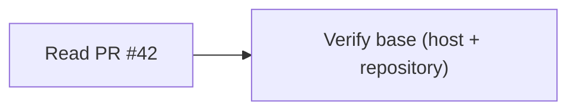

# Write a Visual-First PR Description

Give reviewers a ten-second view of the change, evidence it works, and the
consequences of merging. Draft by default. Use `v1-land-pr` to open a PR or
prepare it for review, and `v1-prove-work` to record browser evidence.

## Verify the change

Invoke `/v1-pr-description <PR_URL_or_NUMBER>` in Claude Code or
`$v1-pr-description <PR_URL_or_NUMBER>` in Codex. Prefer the full PR URL.
A bare number needs a GitHub CLI default repository, an explicit `GH_REPO`,
or one unambiguous local remote repository. Without an argument, resolve
the current branch's PR.

Run the bundled [generate.sh](generate.sh) with Bash from the matching checkout.
Use the directory containing this loaded skill. If only the plugin root is
known, use [resolve-skill-root.sh](../../scripts/resolve-skill-root.sh) with
`v1-pr-description generate.sh` to locate it. The helper requires Git, `gh`,
and `jq`. It resolves the PR in its base repository, checks that a local
remote maps to that host and repository, and compares local `HEAD` with
the PR head SHA. It resolves the live base commit from the Git ref API,
rechecks the repository identity, and requires a successful fetch of the
same commit. The PR metadata's `baseRefOid` can be historical.

Use the helper's exit 0 and its reported base and head SHAs to inspect the
actual diff and commit range. Exit 2 means the diff context could not be
verified. Stop and report the reason. If verifying manually, apply the same
identity and exact-SHA checks before using a local diff. Cached tracking
refs cannot substitute for a failed fetch.

When `v1-land-pr` requests a draft for a new PR, verify the intended base
repository, branch, and live commit and the exact head to be submitted.
Use those revisions to draft locally and return the title and body for the
caller to create the PR.

Read the existing PR body, relevant diff hunks, commit intent, repository
guidance, PR template, and available validation. Preserve the selected
template's headings and required fields, plus accurate checklist state,
reviewer notes, linked tickets, and required wording. Fit the visual,
evidence, and merge consequences into the template's structure. Correct
stale claims against the verified diff.

## Draft the title and body

Keep the title concise and specific. Preserve required issue keys and follow
the repository's title conventions.

Use these three headings in order when the repository supplies no template.

### `## Summary`

Pair one or two crisp sentences with the smallest visual that makes the
change obvious in ten seconds. Choose the representation that fits the diff.

| Change | Visual |
| --- | --- |
| Logic or branching | Pseudocode |
| Runtime control flow | Call tree |
| UI composition | Component tree |
| File layout or refactor | Shallow file tree |
| Before/after structure | Small structural `diff` sketch |
| Interaction or data flow | Small Mermaid diagram |

Keep the visual next to the summary sentences. Avoid a long list of changed
files or a recap of the implementation. Use verified symbols, exit codes,
and messages only when they matter to the sketch.

In Mermaid, use neutral IDs such as `n1` and `n2`. Avoid reserved keywords
as node IDs, including `call`, `end`, `subgraph`, `graph`, `style`, and
`click`. Quote labels with special characters and check the diagram renders.
Use a text sketch if rendering cannot be verified.



### `## Evidence`

Show the concrete before and after. For UI, use screenshots of the same
state on each revision. For logic, show a focused test failing before and
passing after, or exact command output that demonstrates the behavior.
Label each result with its revision or reproduction context. If a run or
capture is missing, say which one and report only what was observed.
Use an explicit evidence gap in place of any placeholder. Check that
reviewers can open linked evidence and that it covers the stated revision.

### `## Merge Danger`

- **Door** — Say `two-way` when a revert restores behavior, or `one-way`
  when durable effects remain or reversal needs additional intervention.
  Give the actual recovery step or the reason reversal is limited.
- **Blast Radius** — Name what breaks if the change goes wrong. Identify
  the affected users, callers, data, or workflows and any limit you verified.

## Return or post the draft

Check the title and body against the current PR head and base, the template,
required wording, and actual validation before returning or posting. If the
revisions changed, refresh the evidence.

Return the proposed title and body for a draft-only request. When the user
authorized updating GitHub, use the verified full PR URL.

```bash
gh pr edit <verified-pr-url> --title "<title>" --body-file <body-file>
```

Read back the title and body from that URL. If the edit or readback fails,
return the draft with the exact blocker and report the remote state as
unverified.
